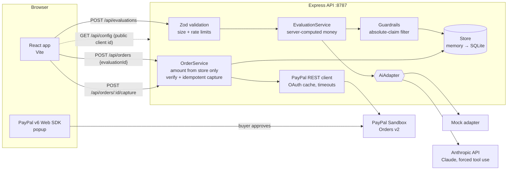

# CartGuardian: implementation plan

Status as of **Tue 27 Oct 2026**, updated **Fri 30 Oct** (see §0). Submission deadline: **Thu 12 Nov 2026, 12:00 PM PST** (that is 20:00 UTC, **22:00 in Johannesburg**). Plan to submit on 11 Nov.

How to read the labels in this document:

- **Verified**: I ran it in a Linux workspace (Node 22.23, npm 10.9) and saw it work.
- **Untested**: written against current docs and type definitions, but not run against the live service.
- **Assumption / Recommendation**: a decision I made because the brief left it open. Change it if it's wrong.

---

## 0. Decisions changed on Fri 30 Oct (these override later sections)

Live status on 30 Oct: the Node milestone 1 works end to end on Mohau's Windows machine against real PayPal Sandbox (CLI capture `11997660J5609872A`, UI purchase `9YY73139J5324721J` / capture `2N824363433053304`, 449.00 USD). Real AI connected the same day: Gemini `gemini-3.5-flash-lite` returned a valid trial in 4.7 s, quoted the server figures exactly and ignored the injected "guaranteed" instruction. Review found over-generous `your_input` labels and a missing "what do you pay now?" question; prompt rules 3 and 7 tightened in response.

| Topic | Was | Now | Sections affected |
|---|---|---|---|
| Hosting | Render (suggested) | **Vercel** | §4 "not done yet", §9 Day 8 |
| Database | In-memory, then SQLite on 31 Oct | **Supabase (Postgres)** | A4, §3 diagram, §5 essential #5 |
| Backend language | TypeScript / Express 5 | **Unchanged.** Python was considered on 30 Oct and dropped: a port would cost 2–3 days for no judging benefit. The Python notes below are kept for after the hackathon | — |
| AI provider | Claude (Anthropic API) | **Gemini free tier** (`AI_PROVIDER=gemini`). Default model changed to `gemini-3.5-flash-lite` on 30 Oct after a probe showed `gemini-3.8-flash` timing out on every request, even a one-word reply, while 3.5-flash-lite returned the full trial in ~3 s. Fallbacks: `gemini-3.1-flash-lite,gemini-3.5-flash`; each model gets at most 12 s while others remain, and `AI_TIMEOUT_MS` (30 s) caps the whole trial. The Anthropic account had no API credit; Gemini is free with no card, available in South Africa, and supports JSON-schema output. Free-tier prompts may be used to improve Google products, so the form now asks users to leave out personal details. Gemini ignores `maxLength`, which Zod re-validation + one repair attempt already covers. The Claude adapter stays as an option | §1, A2, §7, §10 "Tools" |
| AI auth | — | **API key**, not identity federation: no identity provider on the dev machine, judges must run it locally, Vercel isn't one of the listed federation providers | §7 |

### What stays the same

Everything except hosting and the store: the Node/Express backend, React + Vite frontend, API contract, prompt and guardrails, PayPal Orders v2 flow, and every security rule in §4. Supabase plugs in behind the existing `Store` interface in `apps/server/src/store.ts`, so routes don't change.

### What the move to Vercel + Supabase changes technically

- **Serverless means no shared memory.** On Vercel, requests can run in different function instances, so the in-memory store and the in-process capture lock in `services/orders.ts` cannot be relied on. Postgres takes over both jobs:
  - `orders.order_id` primary key, `orders.capture_id` unique.
  - Capture claims the order atomically: `UPDATE orders SET status='CAPTURING' WHERE order_id=$1 AND status='CREATED' RETURNING *`. A request that gets no row back reads the existing row and replays it (or reports "in progress"). A `CAPTURING` row older than ~2 minutes is reconciled by reading the order from PayPal.
  - The deterministic `PayPal-Request-Id: cg-capture-<orderId>` stays, as PayPal's own guard.
- **Rate limiting** per instance in memory is also unreliable on serverless. For the hackathon, a simple Postgres-backed counter or Vercel's own firewall rules are enough. Decide on Day 8.
- **Supabase keys.** The backend uses Supabase's server-side secret key from a Vercel environment variable. The browser never talks to Supabase directly. Enable Row Level Security on every table with no public policies, so a leaked public key can read nothing. Check the key names in the Supabase dashboard, because they have changed over time.
- **Timeouts.** The Vercel function's maximum duration must be above `AI_TIMEOUT_MS` plus one repair attempt. Check the limit for your Vercel plan in the Functions limits docs before the deploy day.

### Python backend (dropped for the hackathon)

If revisited after judging: FastAPI + Pydantic + httpx, same API contract, pytest ports of all 40 scenarios before switching over. Vercel supports FastAPI with zero configuration (Python 3.12–3.14).

### Schedule impact

Supabase replaces the planned SQLite day, and Vercel replaces Render on deploy day, so these cost about the same time as before. The plan is one day behind because real AI slipped from 29 to 30 Oct. Anything not listed keeps the §9 plan.

| Date | Goal | Proof |
|---|---|---|
| Fri 30 Oct | Claude key + `ai:check`; fix the font for prices (slashed zeros) | Valid trial, no "guaranteed"; prices read normally |
| Sat 31 Oct | Trial quality: 10 fixture products, prompt tuning | No fabricated specs, no absolute claims |
| Sun 1 Nov | Supabase project + `schema.sql` with RLS; `SupabaseStore` implementing `Store`, with DB-backed capture claim. **Working demo checkpoint** (local, real AI + Sandbox + Supabase) + backup video | Restart API between approve and capture → still captures |
| Mon 2 Nov | Error-state polish, mobile pass | as §9 Mon 2 Nov |
| Tue 3 Nov | Deploy to Vercel: static web + Express API, env vars, `WEB_ORIGIN` = hosted origin, check the function duration limit against `AI_TIMEOUT_MS` | Sandbox purchase on the hosted URL |
| Wed 4 – Fri 6 Nov | Unchanged: stretch, webhooks, **feature freeze Fri 6 Nov** | as §9 |

---

## 1. Executive recommendation

Build CartGuardian as a **TypeScript monorepo**: React 19 + Vite frontend, Express 5 API, a shared Zod contract package, a pluggable AI adapter (mock now, **Claude via the Anthropic API** as the first real provider), and **PayPal Orders v2** on the server with the **PayPal v6 Web SDK** (`@paypal/react-paypal-js/sdk-v6`) in the browser.

**Value proposition (one sentence):** CartGuardian puts a purchase on trial before you pay: it argues the strongest honest case for and against buying, shows what each claim rests on, and only then hands you a PayPal checkout locked to the price you evaluated.

**The specific AI capability** that makes this more than a chatbot: *structured adversarial evaluation with provenance*. The model must return a schema-validated trial (two cases, verdict, confidence, questions, unverified assumptions) where every argument is tagged with its basis: from the user, general knowledge, or assumption. The server computes all money figures, treats seller text as untrusted, and rewrites any absolute claim ("guaranteed", "risk-free") that slips through. The AI informs the decision; it never touches the amount.

**Milestone 1 is built.** What's in the repo today:

| Step in the vertical slice | State |
|---|---|
| 1. Frontend and backend start independently | **Verified** (`npm run dev:server`, `npm run dev:web`) |
| 2. Enter product + price | Built; UI **typechecked and production-built, not visually inspected** (no browser available in my workspace) |
| 3. Submit to backend | **Verified** over HTTP with CORS |
| 4. Structured AI evaluation | **Verified with the mock adapter.** Claude adapter is **unit-tested against a fake client; not run against the live API** |
| 5. Display evaluation | Built, not visually inspected |
| 6. Create + approve PayPal Sandbox order | Server side **unit-tested with a fake PayPal**; live Sandbox **untested** (my workspace can't reach PayPal and has no credentials) |
| 7. Verify and capture on server | Same as 6: logic **verified by 40 automated tests**, live call **untested** |
| 8. Success / failure state | Built, not visually inspected |

**Single most valuable next action:** create Sandbox credentials and run `npm run paypal:check -w @cartguardian/server`. It proves OAuth, order creation and read-back against real PayPal in under a minute, independent of the UI (details in §7).

---

## 2. Assumptions and unresolved decisions

| # | Decision | What I chose | Why | Revisit if |
|---|---|---|---|---|
| A1 | The two sides of the Purchase Trial | **Assumption:** *The case for* (why it could be worth it) vs *The case against* (why you might hold off or wait), plus a verdict of buy / wait / skip | The brief says "two complementary perspectives" without naming them. An advocate/skeptic pair is the clearest to demo and maps to a real decision | Your original concept had different sides (e.g. "now vs. in a year", "need vs. want"). Only `prompt.ts`, `TrialView.tsx` labels and the schema field names change |
| A2 | AI provider | **Recommendation:** Anthropic Claude, model set by `ANTHROPIC_MODEL` (default `claude-sonnet-5-5`) | Not OpenAI (your constraint); forced tool use gives reliable structured output; official TypeScript SDK with typed errors | You prefer another provider: add one file implementing `AiAdapter` |
| A3 | Who supplies the price | The user types it; the server validates and freezes it in the evaluation record | No product catalogue in an MVP. The rule that matters is *after* evaluation: the browser and the model can never change the amount | You add a product-search sponsor tool (e.g. Channel3), then the server should fetch the price itself |
| A4 | Database | **In-memory store** in milestone 1, behind a `Store` interface; **SQLite via `node:sqlite`** on Day 5 | Persistence only matters once orders must survive a restart (deploys, the capture-after-restart edge case) | — |
| A5 | PayPal frontend SDK | **v6 Web SDK** through `@paypal/react-paypal-js@10` (`/sdk-v6` entry) | It's what the package now documents by default and what PayPal's migration guide points to; judges are PayPal developer advocates | v6 misbehaves in your browser: the v5 `PayPalScriptProvider`/`PayPalButtons` API is still in the same package |
| A6 | Currencies | USD, EUR, GBP, CAD, AUD (all 2-decimal) | Keeps money maths simple. ZAR is not offered: confirm PayPal's supported-currency list before adding any currency | Your Sandbox merchant account is set to another currency |
| A7 | Max order | 5000.00 | Hackathon demo; limits blast radius of bugs | — |
| A8 | Presentation mode | `presentationMode="popup"` | Redirect mode would unload the React app mid-flow; handling the return needs the session hook, not worth it in milestone 1 | Popups are blocked on your demo device |

**Unresolved, needs you:** your original definition of the two Trial sides (A1); whether you have a PayPal developer account yet; which machine and browser you'll record the demo on.

---

## 3. Architecture

### System diagram



### How evaluation and payment interact

```mermaid
sequenceDiagram
  autonumber
  participant B as Browser
  participant S as CartGuardian API
  participant A as AI adapter
  participant P as PayPal Sandbox

  B->>S: POST /api/evaluations {productName, price "449.00", currency, usage}
  S->>S: validate, normalise amount, compute cost per use
  S->>A: trial request (listing wrapped as untrusted, metrics given)
  A-->>S: structured trial (validated, 1 repair retry)
  S->>S: guardrails, store evaluation incl. frozen amount
  S-->>B: 201 {evaluation}
  B->>S: POST /api/orders {evaluationId}   (no amount sent)
  S->>P: POST /v2/checkout/orders  amount from store, reference_id = evaluationId
  P-->>S: order id (CREATED)
  S-->>B: {orderId}
  B->>P: buyer logs in with Sandbox personal account, approves (popup)
  B->>S: POST /api/orders/:id/capture
  S->>S: order must exist in store; replay if already COMPLETED; in-flight lock
  S->>P: POST /v2/checkout/orders/:id/capture  PayPal-Request-Id: cg-capture-:id
  P-->>S: COMPLETED + capture
  S->>S: verify order id, reference_id, capture status, amount + currency
  S-->>B: 200 {order: COMPLETED, captureId}
```

### Repository structure

```
cartguardian/
├── package.json              npm workspaces + root scripts
├── tsconfig.base.json
├── .nvmrc                    Node 22
├── LICENSE                   MIT (Devpost requires a visible licence)
├── README.md                 judge-facing quick start
├── docs/PLAN.md              this file
├── packages/shared/src/index.ts     Zod schemas + types used by both apps
├── apps/server/
│   ├── .env.example
│   ├── src/
│   │   ├── index.ts          boot + startup banner
│   │   ├── app.ts            routes, CORS, helmet, rate limits, body limit
│   │   ├── config.ts         env parsing, fail-fast checks
│   │   ├── money.ts          integer minor-unit maths
│   │   ├── errors.ts         HttpError + safe error handler
│   │   ├── store.ts          Store interface + MemoryStore
│   │   ├── ai/               types, prompt, guardrails, mock, anthropic, factory
│   │   ├── paypal/client.ts  Orders v2 REST client
│   │   └── services/         evaluations.ts, orders.ts
│   ├── scripts/              paypal-check.ts, ai-check.ts
│   └── test/                 40 vitest + supertest tests
└── apps/web/
    ├── .env.example
    ├── index.html, vite.config.ts
    └── src/
        ├── main.tsx, App.tsx, api.ts, styles.css
        └── components/       ProductForm, TrialView, Checkout
```

**Trade-offs, briefly.** Express over Fastify/Nest: least ceremony, Express 5 forwards async errors natively. Raw `fetch` to PayPal over `@paypal/paypal-server-sdk`: every header (idempotency, `Prefer`) and error field is visible, which helps debugging and the judges reading the code; the server SDK is a fine swap later. A shared Zod package instead of OpenAPI codegen: one source of truth with zero build step, at the cost of shipping Zod to the browser (~100 kB gzip total bundle today).

### API

All bodies are JSON. Errors always look like `{"error":{"code","message","details?"}}`. Body limit 16 kB.

| Method & path | Purpose | Rate limit |
|---|---|---|
| `GET /api/health` | Liveness + which integrations are configured | none |
| `GET /api/config` | Public PayPal client ID, currencies, max price | none |
| `POST /api/evaluations` | Run a Purchase Trial | 10/min/IP |
| `GET /api/evaluations/:id` | Fetch a stored evaluation | none |
| `POST /api/orders` | Create PayPal order for an evaluation | 20/min/IP |
| `POST /api/orders/:orderId/capture` | Verify and capture | 20/min/IP |
| `GET /api/orders/:orderId` | Stored status + live PayPal status | none |

**POST /api/evaluations**

```json
{
  "productName": "Espresso machine with built-in grinder",
  "price": "449.00",
  "currency": "USD",
  "description": "15-bar pump... (optional, untrusted, ≤2000 chars)",
  "intendedUse": "Replace my daily café latte (optional, ≤500)",
  "usesPerMonth": 22,
  "lifetimeMonths": 36
}
```

Validation: `productName` 2–120 chars after trim; `price` must be a **string** matching `^(0|[1-9]\d{0,5})(\.\d{1,2})?$`, > 0 and ≤ 5000; `currency` in the allow-list; `usesPerMonth` integer 0–1000; `lifetimeMonths` integer 1–240; control characters stripped from text.

`201` response (abridged):

```json
{
  "evaluation": {
    "id": "c561dd04-8db8-401a-99d6-05b24ad79912",
    "productName": "Espresso machine with built-in grinder",
    "amount": { "currency": "USD", "value": "449.00" },
    "metrics": {
      "totalExpectedUses": 792,
      "costPerUse": { "currency": "USD", "value": "0.57" },
      "costPerMonth": { "currency": "USD", "value": "12.47" }
    },
    "trial": {
      "buyCase": { "headline": "...", "arguments": [{ "point": "...", "basis": "your_input" }] },
      "skipCase": { "headline": "...", "arguments": [{ "point": "...", "basis": "assumption" }] },
      "verdict": "buy",
      "confidence": "medium",
      "verdictRationale": "...",
      "questionsBeforeBuying": ["..."],
      "unverifiedAssumptions": ["..."]
    },
    "provider": "anthropic",
    "model": "claude-sonnet-5-5",
    "policyFlags": [],
    "disclaimer": "CartGuardian offers a structured second opinion, not financial advice..."
  }
}
```

Errors: `400 VALIDATION_FAILED` (with per-field `details`), `413 PAYLOAD_TOO_LARGE`, `429 RATE_LIMITED`, `502 AI_INVALID_OUTPUT | AI_AUTH | AI_UPSTREAM`, `503 AI_RATE_LIMITED`, `504 AI_TIMEOUT`.

**POST /api/orders** — body `{"evaluationId":"<uuid>"}`. Any `amount`/`currency` fields are ignored (a test proves it). `201 {"order":{"orderId":"5O190127TN364715T","status":"CREATED","amount":{...},...}}`. Errors: `404 EVALUATION_NOT_FOUND`, `503 PAYPAL_NOT_CONFIGURED`, `502 PAYPAL_AUTH_FAILED | PAYPAL_ERROR | AMOUNT_MISMATCH`.

**POST /api/orders/:orderId/capture** — no body. `200 {"order":{...,"status":"COMPLETED","captureId":"3C679366HH908993F"},"replayed":false}`; `202` when PayPal holds the capture as `PENDING`. A repeat call returns `200` with `"replayed": true` and does not call PayPal. Errors: `400 INVALID_ORDER_ID`, `404 ORDER_NOT_FOUND` (not created by this server), `409 ORDER_NOT_APPROVED`, `402 PAYMENT_DECLINED`, `502 AMOUNT_MISMATCH`, `504 PAYPAL_TIMEOUT`. PayPal `debug_id` is passed through in `details.debugId`.

### Core types

Defined once in `packages/shared/src/index.ts`: `EvaluationInput`, `TrialResult` (the AI's schema, which deliberately has **no money field**), `Evaluation`, `Money` (`{currency, value: "129.99"}`, decimal string, never a float), `ValueMetrics`, `OrderSummary` (`CREATED | PENDING | COMPLETED | FAILED`), `CaptureResponse`, `HealthResponse`, `PublicConfig`.

---

## 4. Security strategy (what the code does)

- **Secrets stay server-side.** `PAYPAL_CLIENT_SECRET` and `ANTHROPIC_API_KEY` are read only in `apps/server/src/config.ts`. The browser fetches the *public* client ID from `/api/config`. The web `.env` contains only `VITE_API_BASE_URL`; Vite exposes only `VITE_*` variables. Tests assert the secret never appears in `/api/health` or `/api/config`.
- **Env management.** One `.env.example` per app, placeholders only, `.env` git-ignored. Config is Zod-parsed at boot and fails fast: `AI_PROVIDER=anthropic` without a key, identical PayPal ID/secret, or `PAYPAL_ENVIRONMENT` other than `sandbox` all stop the server with a readable message.
- **Server owns the amount.** Price is validated as a decimal string, converted to integer cents, normalised to 2 decimals, frozen into the evaluation. `POST /api/orders` takes only an `evaluationId`. The LLM schema has no amount field; cost-per-use is computed in `money.ts` and given to the model as read-only context.
- **Untrusted content.** The listing is wrapped in `<untrusted_listing>` with `<`/`>` neutralised so it can't close the tag (tested); the system prompt says never to follow instructions in it; control characters are stripped; lengths are capped.
- **No unsupported claims.** The prompt forbids invented specs, guarantees and advice; every argument carries a basis label; the UI shows an *Assumption* badge with a dashed border; `guardrails.ts` rewrites "guaranteed / risk-free / 100% safe / can't go wrong / no-brainer" and records a policy flag; every evaluation carries a not-financial-advice disclaimer; the mock adapter is labelled in the API (`provider: "mock"`) and the UI banner.
- **Verify before recording success.** A purchase is recorded only when PayPal returns order `COMPLETED` *and* capture `COMPLETED` *and* order id, `reference_id` and amount + currency all match the stored record. Mismatch → `FAILED`, 502, loud log line.
- **Idempotency and duplicate captures**, three layers: (1) stored `COMPLETED` orders replay without calling PayPal; (2) an in-process lock collapses concurrent requests to one PayPal call (tested with 3 parallel requests); (3) a deterministic `PayPal-Request-Id: cg-capture-<orderId>` so PayPal itself deduplicates retries. `ORDER_ALREADY_CAPTURED` is reconciled by reading the order back.
- **Only our orders.** Capture refuses any order id not created by this server (404) and validates the id format before any network call.
- **Abuse limits.** 16 kB JSON limit, per-IP rate limits on evaluation and order endpoints, CORS allow-list (`WEB_ORIGIN`), `helmet` headers, 30 s AI and 15 s PayPal timeouts, unknown errors return a generic 500 without internals.

Not done yet (planned): webhook verification (Day 7), durable idempotency across restarts (Day 5), deploy-time `TRUST_PROXY=1` so rate limiting sees real client IPs (Day 8).

---

## 5. MVP scope and acceptance criteria

**Essential (must ship):**
1. Purchase Trial: two cases with basis labels, verdict + confidence, questions, unverified assumptions, server-computed cost per use.
2. Real AI provider wired, mock fallback clearly labelled.
3. PayPal Sandbox checkout end to end: create → approve → server verify + capture → receipt.
4. Clear failure states: declined, cancelled, not approved, timeout, mismatch, misconfigured.
5. Persistence of evaluations and orders across restarts.
6. Hosted demo + README a judge can follow + public repo with licence + video under 3 minutes.

**Stretch (only after the core flow is green on the deployed build):**
- *Cross-examination*: click any argument to challenge it; the model re-argues that side with the user's rebuttal.
- *Cooling-off*: on a "wait" verdict, save the evaluation and offer checkout later at the same frozen price.
- Webhook-driven status (`PAYMENT.CAPTURE.COMPLETED` / `DENIED`) with signature verification.
- Refund within a self-imposed regret window via Payments v2 capture refund.
- Product lookup via a sponsor tool so the server, not the user, supplies the price.

**Acceptance criteria for milestone 1** (✅ = verified by me, ☐ = for you to confirm on your machine):
- ✅ `npm install` then `npm run check` passes (typecheck, 40 tests, production build).
- ✅ `GET /api/health` returns `status: ok` with provider and PayPal flags.
- ✅ A valid evaluation returns 201 with normalised amount and correct cost per use; invalid prices return 400.
- ✅ Order creation sends the stored amount and ignores client-supplied amounts (automated test).
- ✅ Capture is idempotent and concurrency-safe; amount mismatch is never recorded as success (automated tests).
- ✅ UI renders the form, trial and checkout correctly in your browser (confirmed by you, 30 Oct, dark mode).
- ✅ `npm run paypal:check` succeeds with your Sandbox credentials (confirmed by you, 30 Oct).
- ✅ A Sandbox buyer completes a purchase in the UI (30 Oct: order 9YY73139J5324721J, capture 2N824363433053304, 449.00 USD). Still worth confirming the capture in the Business account's activity.
- ☐ `npm run ai:check` with `AI_PROVIDER=anthropic` returns a valid trial and does not follow the injected instruction in its sample listing.

---

## 6. Setup commands

The code is already scaffolded; these are the commands to run it. (For reference, the scaffold is plain `npm init` + workspaces; no generator was used, so there's nothing to re-run.)

Prerequisites: Node **22.12 or newer** (`node -v`), npm 10+. With nvm: `nvm install && nvm use` in the repo root reads `.nvmrc`.

```bash
# 1. Unpack and install (one install for all workspaces)
unzip cartguardian.zip && cd cartguardian
npm install

# 2. Prove the toolchain: typecheck + 40 tests + web build
npm run check

# 3. Create local env files (placeholders only; mock AI, PayPal off)
cp apps/server/.env.example apps/server/.env
cp apps/web/.env.example apps/web/.env
```

**Terminal 1 — API**
```bash
npm run dev:server
# expect:
# CartGuardian API listening on http://localhost:8787
#   AI provider : mock (mock-v1)  <- MOCK: evaluations are rule-based
#   PayPal      : sandbox, NOT CONFIGURED (checkout disabled)
```

**Terminal 2 — web**
```bash
npm run dev:web
# open http://localhost:5173
```

**Terminal 3 — smoke checks**
```bash
curl -s localhost:8787/api/health
curl -s -X POST localhost:8787/api/evaluations -H 'Content-Type: application/json' \
  -d '{"productName":"Standing desk","price":"349.5","currency":"USD","usesPerMonth":22,"lifetimeMonths":60}'
```

### Smoke-test checklist

| # | Action | Expected |
|---|---|---|
| 1 | `curl /api/health` | `{"status":"ok", "ai":{"provider":"mock"...}, "paypal":{"configured":false}}` |
| 2 | Open `localhost:5173` | Header shows "AI: mock adapter" and "PayPal Sandbox: not configured" pills |
| 3 | Click "Fill with an example", then "Put it on trial" | Mock banner, verdict "Leans buy", balance beam tilts toward the teal (for) side, cost per use $0.57, cost per month $12.47, two coloured columns with basis badges |
| 4 | Change price to `1.999` and click "Put it on trial" | Inline error under price; no request in DevTools → Network |
| 5 | Scroll to "Decided to buy?" | Notice that checkout is off until PayPal credentials are set |
| 6 | Stop the API, submit again | Red error: "Can't reach the API at http://localhost:8787…" |
| 7 | Add PayPal credentials (§7), restart API | Pill turns to "ready", PayPal button renders |
| 8 | Complete Sandbox payment | Green "Purchased in PayPal Sandbox" panel with order and capture IDs |
| 9 | Close the PayPal popup instead | "Checkout closed. Nothing was charged." |

---

## 7. AI and PayPal configuration and testing

### PayPal Sandbox (do this first)

1. Log in at developer.paypal.com and switch the dashboard toggle to **Sandbox**.
2. **Apps & Credentials → Create App** (type: Merchant). Copy **Client ID** and **Secret** (the secret is behind "Show"). These are Sandbox values; live ones won't work against `api-m.sandbox.paypal.com`.
3. **Testing Tools → Sandbox Accounts.** PayPal pre-creates a *Business* (merchant, receives money) and a *Personal* (buyer, pays) account. Note the Personal account's email; use "View/Edit account" to see or reset its password. You log into the popup with the **Personal** account, never the Business one.
4. Put the values in `apps/server/.env`:
   ```
   PAYPAL_CLIENT_ID=<sandbox client id>
   PAYPAL_CLIENT_SECRET=<sandbox secret>
   ```
5. Run the isolated check:
   ```bash
   npm run paypal:check -w @cartguardian/server
   # ✓ OAuth token obtained and order created: 5A43... (PAYER_ACTION_REQUIRED)
   # ✓ Order read back: status PAYER_ACTION_REQUIRED
   # To test approval + capture manually: 1. Open https://www.sandbox.paypal.com/checkoutnow?token=...
   ```
6. Optional full server-side loop without the UI: open the printed link, approve with the Personal account, then
   `npm run paypal:check -w @cartguardian/server -- capture <ORDER_ID>` → `✓ Capture: order COMPLETED, capture ... COMPLETED 1.00 USD`.
7. Restart `npm run dev:server`, reload the web app, run a trial, click the PayPal button, approve with the Personal account. Confirm the capture ID in the receipt also appears in the Business account's activity at sandbox.paypal.com.

*(Step 5 confirmed on your machine on 30 Oct 2026. `PAYER_ACTION_REQUIRED` is expected: the order is created with a `payment_source.paypal.experience_context`, so PayPal waits for the buyer instead of reporting `CREATED`. Steps 6–7 also confirmed on 30 Oct: CLI capture 11997660J5609872A for 1.00 USD, and a full UI purchase.)*

### AI provider (Claude)

1. Create an API key in the Claude Console (console.anthropic.com) and add credit if your account requires it.
2. In `apps/server/.env`:
   ```
   AI_PROVIDER=anthropic
   ANTHROPIC_API_KEY=<your key>
   ANTHROPIC_MODEL=claude-sonnet-5-5
   ```
   `claude-sonnet-5-5` is the default because it's a current model ID at the time of writing; confirm it in the Anthropic models documentation (docs.claude.com) and change the variable, not the code, if you want a different one.
3. Isolated check: `npm run ai:check -w @cartguardian/server`. Expect a JSON trial and `✓ Valid structured trial in N ms`. The sample listing contains a prompt-injection line; the output should not claim anything is "guaranteed" (and if it does, `Guardrail flags` will be ≥ 1).
4. Restart the API; the header pill switches from "mock adapter" to the model name.

How the adapter works: a single forced tool call (`tool_choice: {type: "tool", name: "record_purchase_trial"}`) whose `input_schema` is generated from the Zod `TrialResultSchema`; the result is re-validated with Zod; on failure the errors are sent back as a `tool_result` with `is_error: true` for one repair attempt; SDK `maxRetries: 1` covers one transient 429/5xx/timeout.

---

## 8. Troubleshooting guide

| Symptom | Likely cause | Inspect | Fix |
|---|---|---|---|
| `npm install` fails with `EBADENGINE` or syntax errors at start | Node < 22.12 | `node -v` | `nvm install 22 && nvm use` (repo has `.nvmrc`) |
| `Cannot find module '@cartguardian/shared'` | Installed inside an app folder instead of root, so workspaces weren't linked | `ls node_modules/@cartguardian` at root | Delete all `node_modules`, run `npm install` **from the repo root** |
| Peer-dependency warnings from React or PayPal | Mixed React majors | `npm ls react` | Keep a single React 19; `npm dedupe` |
| Port in use (`EADDRINUSE` / Vite "Port 5173 is in use") | Old process | `lsof -i :8787` / `:5173` | Kill it, or change `PORT` (and `VITE_API_BASE_URL`); Vite uses `strictPort` deliberately so CORS origin stays predictable |
| UI: "Can't reach the API at http://localhost:8787" | API not running, wrong URL | Terminal 1 output; `curl localhost:8787/api/health` | Start the API; check `VITE_API_BASE_URL`; restart Vite after editing web `.env` |
| Browser console: CORS error / API returns `403 CORS_ORIGIN_DENIED` | Page origin not in `WEB_ORIGIN` (e.g. `127.0.0.1` vs `localhost`, or deployed URL) | DevTools → Network → request `Origin` header | Add the exact origin to `WEB_ORIGIN` (comma-separated), restart API |
| Server exits: `AI_PROVIDER=anthropic but ANTHROPIC_API_KEY is empty` | Key missing or `.env` in the wrong folder | `ls apps/server/.env` | The server `.env` lives in `apps/server/`, not the repo root |
| `502 AI_AUTH` | Invalid/revoked key, or key from another org | Server log `AI error (auth)` | Regenerate key; check no stray quotes/spaces |
| `502 AI_UPSTREAM` "model ... was not found" | Model ID typo or not available to your account | Server log | Set `ANTHROPIC_MODEL` to an ID listed in the Anthropic docs |
| `504 AI_TIMEOUT` | Slow response or network | Server log timing | Raise `AI_TIMEOUT_MS` (max 120000); retry |
| `503 AI_RATE_LIMITED` | Provider rate limit / low tier | Response headers in server log | Wait; lower usage; keep `AI_PROVIDER=mock` for UI work |
| `503 AI_RATE_LIMITED` with Gemini, server log mentions `RESOURCE_EXHAUSTED` | Free-tier per-minute or daily quota used up | Server log `provider said: 429 ...`; quota page in AI Studio | Wait a minute (per-minute) or until the daily reset; keep `AI_PROVIDER=mock` for UI-only work; don't run the fixture set in a tight loop |
| Every trial times out (`DEADLINE_EXCEEDED`) | The model isn't serving free-tier requests right now | `npm run ai:check -w @cartguardian/server -- probe [model]`: if step 1 (one word) also fails, it's the provider, not our request | Switch `GEMINI_MODEL` to a model whose probe passes; keep the busy one last in `GEMINI_FALLBACK_MODELS` or drop it |
| Gemini `503 ... high demand` / `UNAVAILABLE` | The free model is overloaded (seen on `gemini-3.8-flash`, 30 Oct) | `ai:check` detail line | Retry later, or set `GEMINI_FALLBACK_MODELS` to other models from `npm run ai:check -w @cartguardian/server -- models`; the adapter tries them in order and records which one answered |
| `502 AI_AUTH` with Gemini | Key typo, or key deleted in AI Studio (Gemini reports this as a 400 "API key not valid") | `npm run ai:check` prints `Provider said: ...` | Create a new key at aistudio.google.com, paste into `GEMINI_API_KEY`, restart |
| Anthropic `400 ... credit balance is too low` | API usage is prepaid and billed separately from Claude.ai plans | `ai:check` detail line | Buy credit under Plans & Billing, or use `AI_PROVIDER=gemini` |
| `502 AI_INVALID_OUTPUT` | Model output failed schema twice | Run `npm run ai:check` to see raw behaviour | Usually a too-strict limit; check which field failed in the log, adjust prompt or limit in `shared` |
| `paypal:check` → `401 AUTH_FAILED ... invalid_client` | Wrong secret, Live credentials, or client ID pasted in both fields | Compare with Sandbox tab of Apps & Credentials | Copy Sandbox Client ID **and** Secret again; server refuses identical values |
| PayPal button area: "PayPal couldn't load" | Bad/missing client ID in browser, ad blocker, offline | `curl localhost:8787/api/config` → `paypalClientId` | Set `PAYPAL_CLIENT_ID`, restart API, reload; disable blockers on localhost |
| Popup login fails | Using the Business account or a real PayPal login | Sandbox Accounts page | Log in with the Sandbox **Personal** account |
| `409 ORDER_NOT_APPROVED` | Capture called before approval (closed popup, back button) | Response `details.debugId` | Click the button again; a new order is created |
| `402 PAYMENT_DECLINED` | Sandbox funding source declined | debugId in UI | Choose another funding source; or edit the Personal account balance/card in the Sandbox dashboard |
| `404 ORDER_NOT_FOUND` on capture after restarting the API | Milestone 1 store is in memory | — | Start a new trial; fixed by SQLite on Day 5 |
| `502 AMOUNT_MISMATCH` | Captured amount differs from evaluated price (should never happen) | Server log line `AMOUNT MISMATCH on ...` | Investigate before demo; refund in Sandbox dashboard |
| Currency error at order creation (e.g. `CURRENCY_NOT_SUPPORTED`) | Currency not enabled for the Sandbox merchant | Server log `PayPal create failed: 422 ...` | Use USD for the demo, or enable the currency on the Business account |
| Double charge worry | Double-click or network retry | `replayed: true` in capture response; Business account activity | Already handled by three idempotency layers; tests `orders.test.ts` |
| Edited `.env` but nothing changed | Env is read at startup; Vite inlines `VITE_*` at start | Startup banner | Restart the API (`tsx watch` doesn't restart on `.env` edits; verified); restart Vite for web `.env` |
| `429 RATE_LIMITED` while developing | 10 evaluations/min/IP default | — | Raise `RATE_LIMIT_EVALUATIONS_PER_MINUTE` in server `.env` |

When reporting a PayPal problem to anyone (forums, PayPal support), include the `debug_id` the server logs and the UI shows.

---

## 9. Day-by-day schedule (27 Oct – 12 Nov)

Evenings/weekend pacing assumed; each day has one goal and one proof.

| Date | Goal | Proof it's done |
|---|---|---|
| **Tue 27 Oct** | Milestone 1 running on your machine | `npm run check` green; smoke checklist 1–6 |
| **Wed 28 Oct** | PayPal Sandbox live | `paypal:check` + capture; checklist 7–9 in the UI |
| **Thu 29 Oct** | Real AI | `ai:check` with Claude; 3 manual trials look sensible |
| **Fri 30 Oct** | Trial quality: 10 fixture products (cheap/expensive, vague/detailed, injection, zero usage); tune prompt | Fixture run saved; no fabricated specs, no guarantees |
| **Sat 31 Oct** | Persistence: `SqliteStore` via `node:sqlite`, orders unique on order id | Restart API between approve and capture → still captures |
| **Sun 1 Nov** | **Working demo checkpoint**: full flow with real AI + Sandbox. Record a rough backup video today | Video file exists |
| **Mon 2 Nov** | Error-state polish; UI review on mobile width; accessibility pass (keyboard, contrast, screen reader labels) | Every error code in §8 shows a readable message |
| **Tue 3 Nov** | Deploy: API and static web on Render (sponsor) or similar; `WEB_ORIGIN`, `TRUST_PROXY=1` | Hosted URL completes a Sandbox purchase |
| **Wed 4 Nov** | Stretch 1: cross-examination (challenge one argument) | Demoable in 15 s |
| **Thu 5 Nov** | Webhooks with signature verification, or stretch 2 if webhooks run long | Webhook event logged against an order |
| **Fri 6 Nov** | Frontend tests (Vitest + Testing Library for checkout states). **Feature freeze 23:59** | `npm run check` green on main |
| **Sat 7 Nov** | Fresh-clone test on a second machine following README only; fix gaps | A clean clone runs in < 10 min |
| **Sun 8 Nov** | Devpost text, "Tools" section (Claude + PayPal Orders v2 + v6 SDK), architecture diagram, LICENSE visible in GitHub About | Draft submission saved |
| **Mon 9 Nov** | Rehearse the 90-s script; record final video (< 3 min) | Video on YouTube, public |
| **Tue 10 Nov** | Bug-fix only; re-verify hosted demo | Hosted flow green |
| **Wed 11 Nov** | **Submit** | Devpost confirmation |
| **Thu 12 Nov** | Contingency only. Deadline 22:00 SAST | — |

**Fallbacks.** *AI provider fails:* set `AI_PROVIDER=mock` (the UI labels it), demo the mock trial and show the recorded real-AI run; the adapter interface means swapping provider is one file. *PayPal Sandbox fails:* use the 1 Nov backup video for the payment segment, and show the 40 passing tests that exercise create/approve/capture logic; never fake a "success" screen live.

---

## 10. Judging fit, demo script, risks, next steps

### Published judging criteria (from the official Devpost page)

The five criteria are **Technological Implementation**, **Design**, **Potential Impact**, **Innovation/Idea** and **Presentation**. In short: thorough, working, non-trivial use of PayPal and AI; a complete, coherent product rather than a proof of concept; a credible case for a real problem and audience; novelty; and a video that shows the project working end to end and explains the problem, audience and why it matters. Submission must include a functional demo (hosted URL or complete run instructions), a public repo with a visible open-source licence, a "Tools" explanation of the AI used, and a public YouTube video **under 3 minutes**. Special prizes include Best Use of PayPal + AI and Best Use of Agentic Commerce. Source: paypalaihackathon.devpost.com.

How CartGuardian maps (my inference, not official guidance): Technological Implementation → forced structured output, server-owned money, verified idempotent capture, tests. Design → one coherent flow from doubt to receipt. Potential Impact → impulse and regret purchases; the user is the audience, not the merchant. Innovation → AI that argues *against* the sale inside a checkout. Presentation → the script below.

### Three live differentiators

1. **The trial argues both ways and shows its sources.** Paste a seller blurb containing "this pays for itself in 3 months". The trial lists it as an unverified claim; badges show which points came from you vs. assumptions.
2. **The AI can't touch your money.** In a terminal, `POST /api/orders` with `"amount":"0.01"`; PayPal's popup still shows the evaluated price. The model only ever sees the server-computed cost per use.
3. **Verified, idempotent capture.** Replay the capture request: response says `replayed: true`, Sandbox activity shows one payment.

### 90-second demo script

| Time | Screen | Say |
|---|---|---|
| 0–10 s | Empty app | "Most purchase regret starts with one-sided information: the seller's. CartGuardian puts a purchase on trial before you pay." |
| 10–30 s | Fill espresso example, run trial; beam tilts | "It argues the strongest case for and against, and labels every point: from you, general knowledge, or assumption. Cost per use is computed by the server, not guessed by the model." |
| 30–45 s | Point at "Not verified" and the seller claim | "The listing said it pays for itself. CartGuardian treats that as a claim, not a fact, and tells you what to ask before buying." |
| 45–70 s | Click PayPal, approve as Sandbox buyer, receipt | "If you decide yes, checkout is PayPal, locked to the exact price on trial. The server verifies the order with PayPal before recording success." |
| 70–85 s | Terminal: tamper attempt + replayed capture | "The browser can't change the amount, and retries can't charge you twice." |
| 85–90 s | Logo | "CartGuardian: a second opinion that lives inside the checkout." |

### Measurable success criteria

- Full flow (trial → Sandbox receipt) in under 60 s on the hosted build.
- Trial p95 latency under 10 s with the real provider.
- 0 schema failures across the 10 fixtures after one repair attempt.
- 0 fabricated hard specs and 0 absolute claims in fixture outputs (manual review + guardrail flag count).
- 0 duplicate captures in replay tests; automated suite green on every commit.
- A judge can go from clone to running app in under 10 minutes using README only.

### Top risks and mitigations

| Risk | Likelihood | Mitigation |
|---|---|---|
| v6 Web SDK behaves differently than its docs in your browser | Medium | Isolated `paypal:check` first; v5 components ship in the same package as fallback |
| Popup blocked on demo device | Medium | Test on the recording machine by 1 Nov; switch to `presentationMode="modal"` if needed |
| AI latency hurts the demo | Medium | Sonnet-class default; loading state; pre-warmed run; mock fallback |
| Model output occasionally invalid | Low–Medium | Forced tool use + Zod + one repair retry; fixtures on Day 4 |
| In-memory store loses orders on deploy restart | High until Day 5 | SQLite on 31 Oct |
| Scope creep from stretch features | High | Freeze on 6 Nov; stretches only after hosted flow is green |
| Rate limiter keyed on proxy IP after deploy | Medium | `TRUST_PROXY=1` on Render/Fly |

### Next step

**Run `npm run paypal:check -w @cartguardian/server` with your Sandbox credentials.** Success looks like `✓ OAuth token obtained and order created` followed by `✓ Order read back`. That single command removes the biggest unknown (your PayPal environment) before you spend time on anything else.
